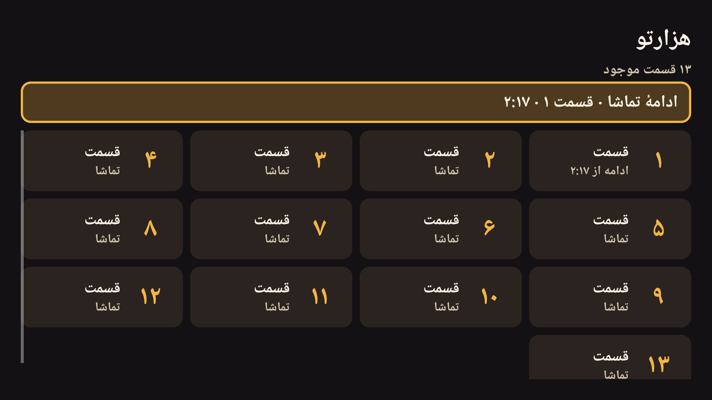
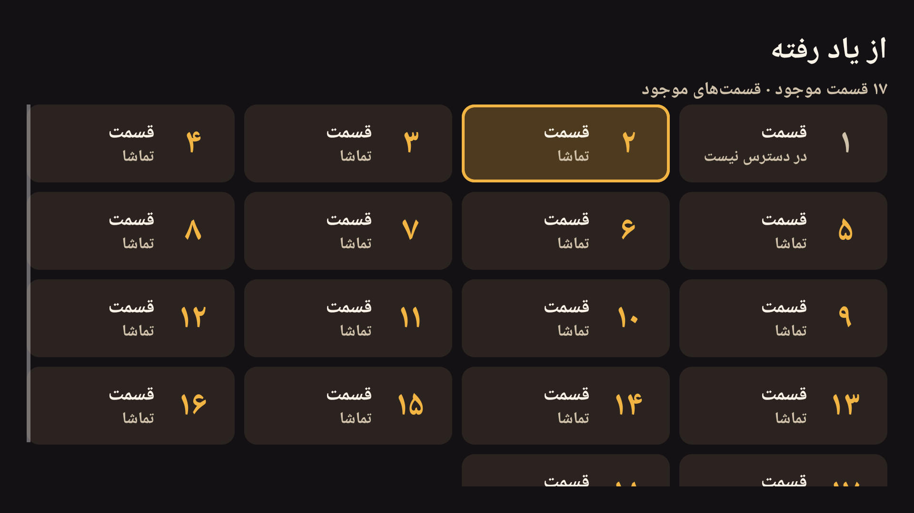

# Persian series interface checkpoint

27 November 2026. Baseline production 3.9.2 / code 18. Development branch `dev/cloud-series-interface`. No production publish or Xiaomi installation.

## Interface

Compact numbered cards use the existing saved palette and Amin Player's restrained gold/focus language without modifying Amin Player. The native RTL grid adapts to two–four columns, with 36sp numbers, 21sp headings, 17sp secondary status and an 82dp card height. Library thumbnails are 104×58dp instead of 144×81dp; title text remains 25sp. Gold border plus a filled selected card makes focus visible independently of text alone.

Continue Watching is initially focused when available; OK starts the exact saved episode. Cards show saved time or watched status. Back from playback restores that episode's card; Back from the grid restores the title. The existing player controls still offer pause, restart, episode selection and next episode. No history migration or player rewrite.

Unavailable cards retain their original number, are visibly labelled and cannot launch playback. D-pad selection skips them. The screen reflects the **approved catalogue**, not a permanent claim that an upload is absent from YouTube. Current ساختمان پزشکان gaps 3/4 remain visible until a later validated catalogue update. Unknown final counts are not invented. Optional verified season bounds are supported for later research-approved data; `channels.json` is unchanged.

## Automated verification

[GitHub run 46059211041](https://github.com/Skyspiriit/Amin-Live-TV/actions/runs/46059211041), source `a70329611e50c6d9d6c0de2180614363ea81b59e`:

- Fresh Ubuntu 24.04 SDK installation, preview assembly, all **29 JVM tests / 7 suites**, zero failures. Includes original catalogue/channel/update/subtitle/documentary tests and seven new numbering/boundary/timestamp tests.
- Debug and release lint pass with **0 errors**. At this run: 23 debug / 22 release warnings, mostly existing SDK/dependency/icon/unused-resource advice. The obsolete one-argument continuation string is removed in the final checkpoint; dependency upgrades are deferred.
- **Android TV API 30 / Android 11, x86, 1080p**, KVM on GitHub: two instrumentation tests passed. Real remote key events cover Left/Right/Down/Up, RTL numbering, unavailable-card enablement, Back/title focus, one-click continuation and exact 137.25-second stored bookmarks across Activity restarts.
- Local clean-source preview also passed both instrumentation tests on **Android TV API 34 / Android 14, x86, 1080p**. Screenshots above are API 34. Initial screenshot-directory/timing defects were corrected and the tests rerun; neither required an application playback change.

The cloud development environment separately built baseline `main` with 22 tests and lint 0 errors/17 warnings. Its unaccelerated TV emulator did not boot in five minutes; that is **not** an emulator pass. GitHub KVM results above supply the automated cloud UI evidence.

## Actual YouTube check — local API 34 emulator only

Existing هزارتو episode 1, `D_VP8L4z0X0`, official embedded player, duration 2747.581s:

| Check | Observed result |
|---|---|
| Start / pause | Decoded playback observed; seek to 137s, paused state 2; saved exact position 137s |
| Back / reopen | Same stable IDs, IFrame start=137; first sampled playing position **137.641491s** |
| Full process restart | Back saved **137.621597s**; force-stopped QA app, relaunched; home Continue Watching focused the same episode; reopened with start=137 and sampled **138.508998s** |
| Captions / translation default | App's subtitle flag false, control «زیرنویس خاموش», no translation request; no caption overlay visible in the inspected playback screenshot. YouTube may still enumerate an available caption track; that enumeration alone is not proof captions are displayed. No subtitle implementation changed. |
| Completion | Sought to final three seconds and let playback reach ENDED naturally; saved 2747.581s/completed=true; «قسمت بعد» received remote focus |
| Next episode | OK opened `BEFCZSkcJWc` at start=0; playing sample **0.360295s**, subtitle flag false |
| Cached startup | After disabling emulator Wi-Fi, cold startup still showed the saved episode-two continuation and catalogue/home; Wi-Fi restored. No broad internet-outage or network-failover certification is implied. |

The embedded player accepts whole-second start parameters; the bookmark store retains fractional seconds. Observed resume was within roughly two seconds of the bookmark, including playback elapsed before sampling. External YouTube-app playback cannot supply accurate in-app resume. Ads, provider changes and blocked embeds remain upstream limitations.

## Reliability review and boundaries

Native live playback/failover, documentary queue/subtitles, full-screen/immersive flags, startup/loading/network timeouts and production updater code paths were reviewed and preserved. Original tests passed. This checkpoint does **not** retest every live station, documentary round, offline recovery path or external YouTube-app handoff. No VPN exists in current Amin TV; adjacent VPN/Amin Player work is excluded.

Production package/certificate configuration, version/code, preference formats and stable catalogue IDs are unchanged. Catalogue SHA-256: `0feb14ef663c828a14a186febb0b693fe8f2944df16703162f6fd52969870aba`. Previews are separately labelled `Amin TV Preview`, package `com.enigma.aminlivetv.qa`, signed with an ordinary debug key, not the production key. CI artifacts contain source commit, size and SHA-256. No release-signing credential was provisioned into cloud development or Actions.

## Physical Xiaomi acceptance still required

With specific new permission: install a separate preview, check text at normal seating distance/overscan, remote focus/scroll at the first/last row and multi-season gaps, pause/Back/exact resume after process restart, captions off, restart/next, blocked YouTube handoff, native live TV and documentary regressions on the actual Xiaomi firmware/network. **No physical Xiaomi testing of this checkpoint was performed.** Prior 26 November production updater verification is separate evidence.

Stop here for owner review. Next phase is acceptance plus the documented catalogue authorization/edition audit; no automatic catalogue expansion or production release.
